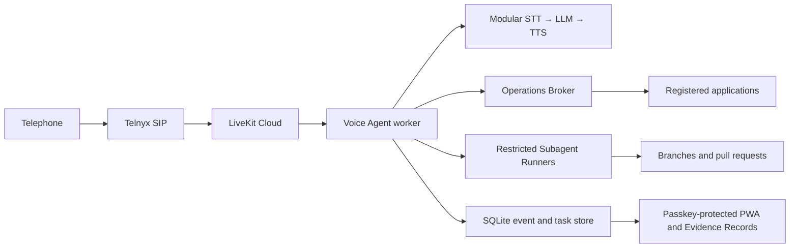

# Voice Agent

A personal, voice-first assistant for discussing codebases, operating Linux services, and delegating deeper work to coding agents while away from a keyboard.

> **Status:** Architecture and product design are complete. The first simulated Durable Task tracer bullet is implemented; telephone and production-service integration remain future slices.

The intended experience begins with a telephone call. The Voice Agent calls back to authenticate the session, carries on a natural conversation, performs narrowly authorized operations, and delegates substantial code investigation or changes to restricted Subagents such as Codex or Claude Code. A PWA provides passkey-protected controls and a visual Evidence Record for every Durable Task.

## Initial destination

Development will proceed in three telephone-led vertical slices:

1. Ask whether Bountywell is healthy, receive a spoken answer, and inspect the supporting Evidence Record in the PWA.
2. Diagnose and recover a guarded, deliberately injected Bountywell API outage without being told its cause.
3. Request a small Keeplore interface improvement, delegate it to Codex in an isolated branch, verify it, open a pull request, and promote it only after a Human Merge.

Typed PWA conversation and WebRTC are later slices. Independent-host recovery and off-host backup implementation are later hardening.

## Intended architecture



The planned implementation is an all-TypeScript pnpm monorepo using LiveKit Agents, Fastify, React and Vite, Zod, and SQLite. Hardened systemd services will run on `stephens.page`; Apache is the replaceable initial TLS and reverse-proxy edge. Prometheus and Grafana provide same-host operational telemetry.

The selected modular voice pipeline begins with AssemblyAI speech-to-text, an OpenAI coordinator model, and Inworld text-to-speech. Provider boundaries remain replaceable, and automatic cross-provider failover is intentionally deferred.

## Safety model

- The Voice Agent has typed capabilities, not an arbitrary shell.
- Code and operations are limited to explicitly Registered Codebases.
- Authority expansion, policy changes, and sensitive debugging require a fresh passkey.
- Subagents work under separate restricted identities in isolated non-production branches and worktrees.
- A Subagent may push a branch and open a pull request, but it cannot write to `main` or merge its own work.
- Every Human Merge triggers a serial, verified Promotion with rollback and a circuit breaker.
- Unattended changes must be recoverable, scoped, auditable, and automatically verified.
- Durable Tasks and idempotent Operations remain authoritative across calls, callbacks, PWA sessions, and process restarts.
- Evidence is derived from append-only events; raw telephone audio is not retained during ordinary use.
- Personal subscription credentials and authority are never inherited by a company or multi-user implementation.

## Repository guide

- [`CONTEXT.md`](CONTEXT.md) defines the project’s domain language.
- [`docs/adr/`](docs/adr/) contains the architectural decisions.
- [`research/`](research/) contains primary-source product and provider research.
- [`docs/agents/`](docs/agents/) configures the issue tracker, triage vocabulary, and domain-document rules used by engineering agents.
- [GitHub Issues](https://github.com/JacobStephens2/voice-agent/issues) will hold specifications and tracer-bullet implementation tickets.

The canonical scope is the single-user Personal Prototype. Any future ETA Voice Agent will be planned separately and may use this repository only as non-normative inspiration.

## Development

The workspace requires Node.js 22 or newer and pnpm 11. From a clean checkout:

```bash
pnpm scenario:bountywell
```

The scenario needs no credentials or network services. It sends the normalized “Is Bountywell healthy?” inquiry through the policy and orchestration path, uses a deterministic typed read-only broker, persists the Durable Task, Operation, and Evidence Events in a temporary SQLite WAL database, verifies idempotent replay and restart recovery, exercises the Fastify read API, and renders the React Evidence Record view.

The CI-ready verification commands are:

```bash
pnpm typecheck
pnpm test
pnpm build
```

The PWA lives in `apps/pwa`; the API, scenario harness, contracts, and durable runtime are isolated workspace modules under `apps/` and `packages/`.
