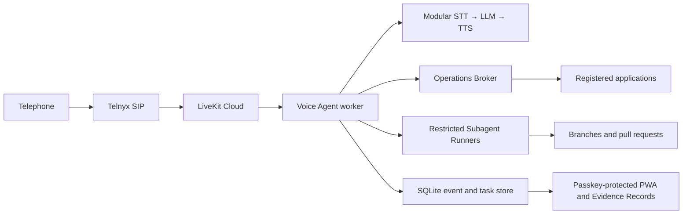

# Voice Agent

A personal, voice-first assistant for discussing codebases, operating Linux services, and delegating deeper work to coding agents while away from a keyboard.

> **Status:** The passkey-protected PWA, durable Bountywell inquiry, Callback Handshake and conversational health answer over Telnyx and LiveKit, read-only Operations Broker, hardened Agent Host release path, Keeplore onboarding with Human Merge Promotion, and the restricted Codex Keeplore Button Trial are implemented. Real PSTN and Keeplore flows remain part of attended deployment acceptance.

The intended experience begins with a telephone call. The Voice Agent calls back to authenticate the session, carries on a natural conversation, performs narrowly authorized operations, and delegates substantial code investigation or changes to restricted Subagents such as Codex or Claude Code. A PWA provides passkey-protected controls and a visual Evidence Record for every Durable Task.

## Initial destination

Development will proceed in three telephone-led vertical slices:

1. Ask whether Bountywell is healthy, receive a spoken answer, and inspect the supporting Evidence Record in the PWA.
2. Diagnose and recover a guarded, deliberately injected Bountywell API outage without being told its cause.
3. Request a small Keeplore interface improvement, delegate it to Codex in an isolated branch, verify it, open a pull request, and promote it only after a Human Merge.

Typed PWA conversation and WebRTC are later slices. Independent-host recovery and off-host backup implementation are later hardening.

## Intended architecture



The implementation is an all-TypeScript pnpm monorepo using LiveKit Agents, Fastify, React and Vite, Zod, and SQLite. Hardened systemd services run on `stephens.page`; Apache is the replaceable initial TLS and reverse-proxy edge. Prometheus and Grafana provide same-host operational telemetry.

The selected modular voice pipeline begins with AssemblyAI speech-to-text, an OpenAI coordinator model, and Inworld text-to-speech. Provider boundaries remain replaceable, and automatic cross-provider failover is intentionally deferred.

## Safety model

- The Voice Agent has typed capabilities, not an arbitrary shell.
- Code and operations are limited to explicitly Registered Codebases.
- Authority expansion, policy changes, and sensitive debugging require a fresh passkey.
- Subagents work under separate restricted identities in isolated non-production branches and worktrees.
- A Subagent may push a branch and open a pull request, but it cannot write to `main` or merge its own work.
- Every Human Merge triggers a serial, verified Promotion with rollback and a circuit breaker.
- Unattended changes must be recoverable, scoped, auditable, and automatically verified.
- Durable Tasks and idempotent Operations remain authoritative across calls, callbacks, PWA sessions, and process restarts.
- Evidence is derived from append-only events; raw telephone audio is not retained during ordinary use.
- Personal subscription credentials and authority are never inherited by a company or multi-user implementation.

## Repository guide

- [`CONTEXT.md`](CONTEXT.md) defines the project’s domain language.
- [`docs/adr/`](docs/adr/) contains the architectural decisions.
- [`research/`](research/) contains primary-source product and provider research.
- [`docs/agents/`](docs/agents/) configures the issue tracker, triage vocabulary, and domain-document rules used by engineering agents.
- [GitHub Issues](https://github.com/JacobStephens2/voice-agent/issues) will hold specifications and tracer-bullet implementation tickets.

The canonical scope is the single-user Personal Prototype. Any future ETA Voice Agent will be planned separately and may use this repository only as non-normative inspiration.

## Development

The workspace requires Node.js 22 or newer and pnpm 11. From a clean checkout:

```bash
pnpm scenario:bountywell
pnpm scenario:callback
pnpm scenario:telephone
```

The scenarios need no credentials or network services. The Bountywell scenario sends the normalized health inquiry through the policy and orchestration path. The Callback Handshake scenario covers inbound admission, the fixed no-command notice, stored callback routing, answering-machine detection, DTMF authorization, one delayed retry, duplicate and reordered delivery, and fail-closed voicemail behavior. The telephone and continuity scenarios cover paraphrases, background-work callback consent, authenticated resumption, call and process loss, safe cancellation, provider failures, generic notification fallback, idempotent replay, and the authenticated 90-day Evidence lifecycle policy. They persist durable state and append-only Evidence Events in temporary SQLite WAL databases and exercise the authenticated Fastify/React Evidence Record surface.

After an exact Human Merge has been promoted, the attended slice-one campaign is
run with:

```bash
./ops/acceptance/run-slice-one.sh
```

The wizard runs automated verification, opens the same-host monitoring review,
and appends five real PSTN attempts across AT&T, Tello, and an outdoor walking
run. Failed attempts remain in the record and reset the consecutive sequence;
the validator refuses to append the terminal acceptance event until every gate
passes. See [`docs/operations/slice-one-acceptance.md`](docs/operations/slice-one-acceptance.md).

Run the attended Bountywell Outage Drill wizard on the Agent Host from a
checkout that contains the script (this branch, or the promoted Release):

```bash
./ops/acceptance/run-bountywell-outage-drill.sh
```

The wizard waits for Human Merge and Promotion of PR #45, installs the narrow
`voice-broker` systemd allowlist, walks the Fresh Passkey grant, arms and proves
the independent recovery timer, starts the guarded drill while the owner is
available, and prints a close comment for issue #11. It does not close the
issue.

Run the attended Keeplore onboarding wizard on the Agent Host:

```bash
./ops/acceptance/run-keeplore-onboarding.sh
```

It inspects the live Keeplore checkout read-only, waits for you to reconcile and
preserve any uncommitted work, moves Keeplore's credentials and other runtime
state into a shared root, cuts its Apache document roots over to the active
Release, walks the Fresh Passkey enrollment,
production-branch rules, minimal CI, the least-privilege GitHub App, and the
Deployment Contract, then promotes one harmless Human Merge, proves rollback
with a controlled failed verification, confirms reconciliation is idempotent,
and prints a close comment for issue #12. See
[`docs/operations/keeplore-onboarding.md`](docs/operations/keeplore-onboarding.md).

After onboarding, enroll and run the restricted Codex Keeplore Button Trial on
the Agent Host:

```bash
./ops/acceptance/run-keeplore-button-trial.sh
```

It verifies the `voice-codex` service boundary, walks the separate Codex,
GitHub, and authenticated Keeplore browser logins, pins an exact source commit,
then guides the exact telephone confirmation and structured-result review. See
[`docs/operations/keeplore-button-trial.md`](docs/operations/keeplore-button-trial.md).

When a later reviewed Release changes root-pinned promotion scripts or systemd
definitions, activate those pins with the separate attended wizard before
running acceptance that depends on them:

```bash
cd /opt/voice-agent/current
./ops/upgrade-agent-host-deployment-authority.sh
```

The wizard accepts only the active immutable Human Merge, displays the complete
authority diff, binds a five-minute root-owned challenge to the exact commit,
uses an attended root approval plus a signed assertion to enroll one existing
owner passkey on first use, verifies a second Fresh Passkey assertion, retains
the previous pin, and rolls back if reactivation fails.
See
[`docs/operations/agent-host-release.md`](docs/operations/agent-host-release.md#attended-deployment-authority-upgrades).

The CI-ready verification commands are:

```bash
pnpm typecheck
pnpm test
pnpm build
pnpm browser:test
```

To generate a ten-minute, single-use Bootstrap Code through existing server access, set the production SQLite path and run:

```bash
VOICE_AGENT_DATABASE_PATH=/path/to/voice-agent.sqlite pnpm auth:bootstrap
```

The command writes only the code to standard output. It never places the code in repository files or passes it as a shell argument. A new code is required for each of the first two independently enrolled passkeys; bootstrap closes permanently only after the one-time Recovery Codes have been displayed and their receipt confirmed.

The PWA lives in `apps/pwa`; the API, authentication lifecycle, scenario harness, contracts, and durable runtime are isolated workspace modules under `apps/` and `packages/`.

## Agent Host release

After the first Human Merge, run the repeatable setup wizard from a clean
checkout on `stephens.page`:

```bash
./ops/setup-agent-host.sh
```

The wizard installs an immutable release, separate hardened API, telephone
worker, and broker services, the narrow Apache vhost, passkey bootstrap, fixed
Bountywell and Registered Telephone revisions, a private Prometheus scrape on
the verified-free localhost port 3472, the ordered Human Merge Promotion
trigger, and bounded Callback Handshake, telephone Bountywell, and direct
Bountywell production smokes. Later
pushes to `main` enqueue every verified Human Merge on the Agent Host; the host
serializes and attempts them in GitHub order. The wizard installs a
repository-scoped, read-only GitHub App PEM and LiveKit credentials into
separate root-only sources; it never accepts key contents through command
arguments. Telnyx SIP credentials remain in the provider configurations. See
[`docs/operations/agent-host-release.md`](docs/operations/agent-host-release.md)
for the service boundary, health checks, and automatic/manual rollback path.
